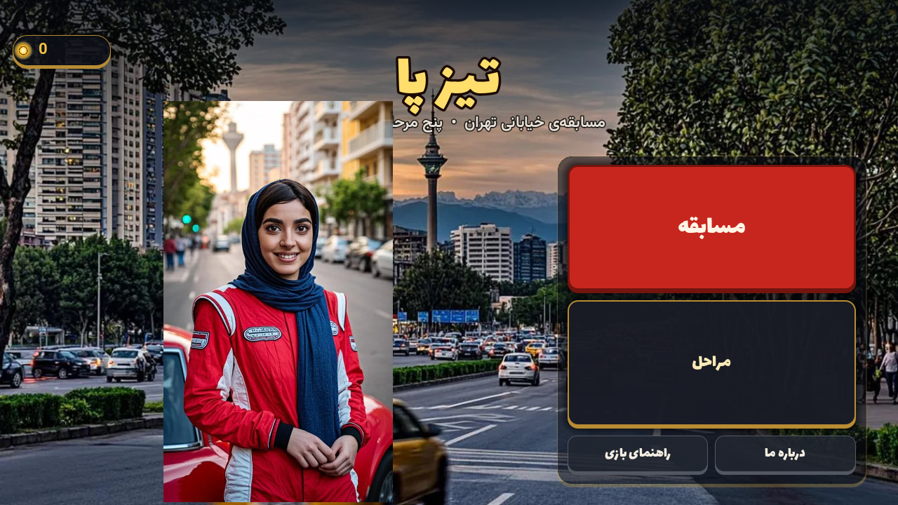
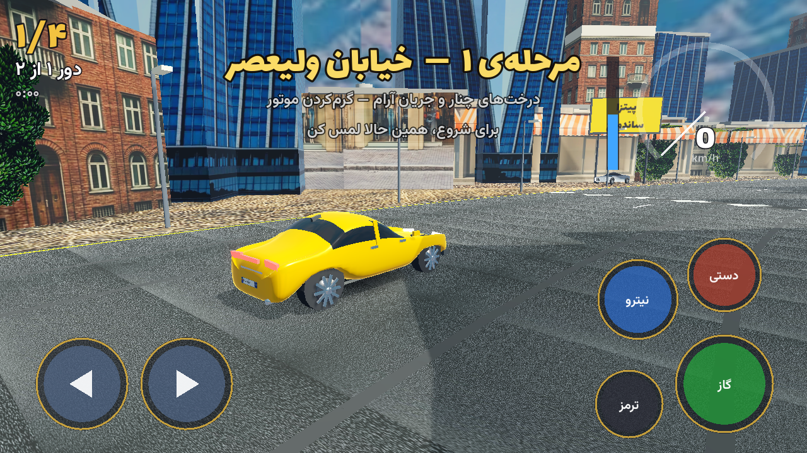
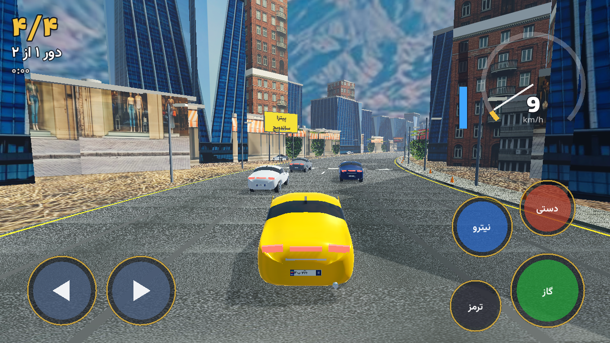
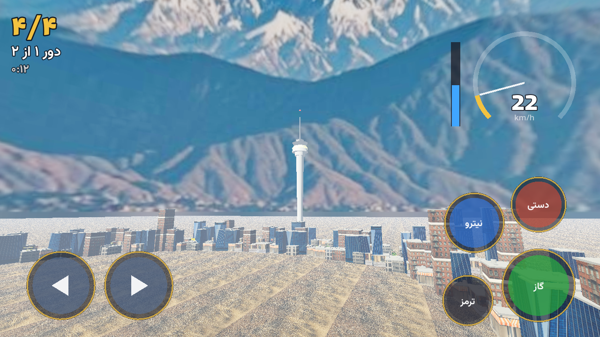
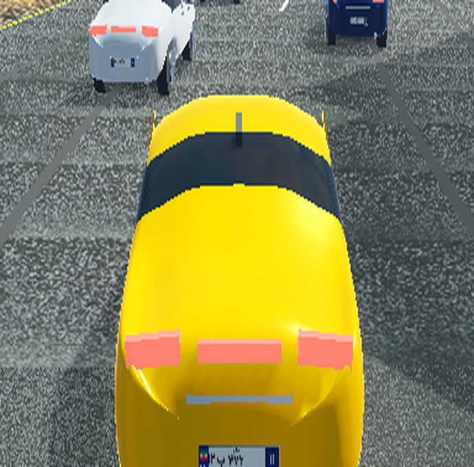

# تیز پا 🏁

مسابقه‌ی خیابانی سه‌بعدی در خیابان‌های تهران — با هلیا پشت فرمان.
دوربین تعقیبی سینمایی، دریفت دستی، نیترو، ترافیک زنده، رقیب‌های بی‌رحم و شهری که بوی تهران می‌دهد: تابلوهای فارسی، بیلبوردها، برج میلاد روشن و کوه‌های برفی البرز افق.



## چی داخلش هست

- **ماشین قهرمان:** سدان طلاییِ مدل‌شده با بلندر (نه مکعب و استوانه!) — شیشه‌ی دودی، رینگ تیره‌ی ده‌پره، قوس گلگیر واقعی و **پلاک تهران ۱۱** جلو و عقب
- **۵ مرحله:** ولیعصر، بازار بزرگ تهران، بزرگراه چمران، تجریش در غروب، و دور میدان آزادی
- **برج میلاد و بنای آزادی** به‌عنوان نشانه‌های شهری — میلاد با سرِ شکافته‌ی معروف، نوارهای نورانی و چراغ سرخِ تپنده
- **دریفت دستی** با رد لاستیک، دود و امتیاز — نیترو با دریفت شارژ می‌شود
- **اینتروی سینمایی:** دوربین دور ماشین‌های خط شروع می‌چرخد، بعد پشت ماشین می‌نشیند
- **HUD لمسی کامل:** دکمه‌های چپ/راست/گاز/ترمز/نیترو/دستی، گیج سرعت — روی هر نسبت تصویری جا می‌شود
- **صحنه‌ی قهرمانی:** سکوی اول، مدال طلا و پرچم ایران

## عکس‌ها

| | |
|---|---|
|  |  |
|  |  |

## اجرا

با [Godot 4.x](https://godotengine.org) پوشه‌ی `game/` را باز کنید:

```
godot --path game
```

## ساخت APK (اندروید arm64)

```
godot --headless --path game --export-release "Android" TizPa.apk
```

نسخه‌ی فعلی: **0.1** (versionCode ثابت = 1)

## ساختار

```
game/
  scripts/        کد بازی (GDScript، با کامنت فارسی)
  assets/models/  مدل سه‌بعدی ماشین (GLB — خروجی بلندر، اسکریپت: scripts/sakht_mashin.py)
  assets/textures/ تکسچرها (آسفالت، تابلوهای فارسی، پلاک تهران ۱۱ و…)
  assets/audio/   موسیقی و جلوه‌های صوتی
  scenes/         صحنه‌های گودوت (boot / menu / game)
scripts/          ابزارهای ساخت (مدل‌ساز بلندر، آهنگ‌ساز، پلاک‌ساز)
```

## کنترل‌ها

| کار | موبایل | کیبورد |
|---|---|---|
| فرمان | کشیدن انگشت یا دکمه‌های چپ/راست | ←/→ یا A/D |
| گاز | دکمه‌ی «گاز» (نگه دار) | ↑ یا W |
| ترمز دستی (دریفت) | دکمه‌ی «دستی» | Space |
| نیترو | دکمه‌ی «نیترو» | Shift |
| ترمز | دکمه‌ی «ترمز» | ↓ |

## اعتبارها

- فونت‌ها: [Vazirmatn](https://github.com/rastikerdar/vazirmatn) و [Lalezar](https://github.com/BornaIz/Lalezar) — با مجوز OFL
- مدل ماشین، تکسچرها و موسیقی: ساخته‌شده با اسکریپت‌های همین ریپو (بلندر + پایتون)
- موتور: [Godot Engine](https://godotengine.org) — مجوز MIT
